# bui-charts

Charts for [BUI](https://github.com/ppmpreetham/BUI)'s Rust binding, `blenderui`: time series, trends,
XY charts, bar gauges, gauges, stats, heatmaps, histograms, state timelines, status histories,
candlesticks, flame graphs, distributed traces, node graphs, and some eighty charts built on them
(category, finance, quality, distribution, matrix, flow, science, diagram, hybrid and earth charts).
Each chart is a component: write its tag in `rsx!`, style it with `class`, feed it from a signal.

- Hover tooltips and crosshairs, legends that show one series alone (click) or toggle one
  (Ctrl+click), drag across a range to zoom (double-click goes home), Ctrl+wheel or pinch zoom,
  arrow keys to step through points, thresholds, value mappings, colour schemes, annotations.
- Charts derive their marks once per revision of their data and reuse them on other renders.
- Light and dark: the frame takes the Blender kit theme's colours, the series a chart theme
  (Catppuccin by default, `themes/catppuccin.json`).

This is the BUI port of `zopra-charts` (GPUI + gpui-kit + zopra): the same charts, props, data formats
and theme files, drawn by BUI's C kit through `blenderui` instead of gpui.

## Cargo

```toml
[dependencies]
bui-charts = { path = "../addons/bui-charts" } # inside a BUI checkout
blenderui = { path = "../bindings/rust/blenderui" }
```

Keep the dependency named `blenderui`: `rsx!` and the chart tags expand to `::blenderui::..` paths.
Building needs what `blenderui` needs (CMake, a C compiler).

## Quick start

```rust
use blenderui::prelude::*;
use bui_charts::*;

#[derive(Clone, PartialEq)]
struct Reading {
    temperature: f64,
    load: f64,
}

#[component]
fn dashboard() {
    let readings = use_signal(vec![
        Reading { temperature: 18., load: 32. },
        Reading { temperature: 24., load: 51. },
        Reading { temperature: 31., load: 77. },
    ]);
    rsx! {
        <div class="flex flex-col gap-4 p-4">
            <XYChart data={readings} class="h-72">
                <Series name="Load" x={|r: &Reading| r.temperature} y={|r: &Reading| r.load} />
            </XYChart>
            <BarGauge data={readings} value={|r: &Reading| r.load} class="h-16" />
        </div>
    }
}

struct Root;

impl Render for Root {
    fn render(&mut self, _: &mut Window, _: &mut Context<Self>) -> impl IntoElement {
        rsx! { <dashboard /> }
    }
}

fn main() {
    Application::new().run(|cx| {
        cx.open_window(WindowOptions::default(), |_, cx| cx.new(|_| Root)).unwrap();
    });
}
```

Things that hold for every chart:

1. **Keep data in a signal** (`use_signal`) and pass the signal: the chart does its work again only
   when the signal is written, not on every render. A plain `Vec` is derived again each render.
2. **Accessors read from a row.** Write the row type on the closures (`|r: &Reading|`); accessors
   that return text return a borrowed `&str`.
3. **Props on a chart are defaults; props on its children (`<Series>`, `<TrendSeries>` ..) override them.**
4. **Theme switches:** `blenderui::set_theme("light")` repaints the windows; call `cx.notify_all()`
   too, so charts render with the other palette.

The docs: [docs/README.md](docs/README.md), one guide, API page and examples page per chart family,
and [theming](docs/theming.md).

## Charts

Each chart is a drop-in component: import it and use its tag.

<table>
<tr>
<td align="center" valign="top" width="25%"><a href="docs/xy-chart/examples.md">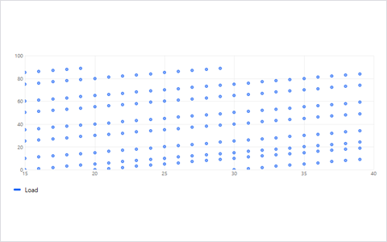</a><br><b>&lt;XYChart&gt;</b><br><a href="docs/xy-chart/guide.md">Guide</a> · <a href="docs/xy-chart/api.md">API</a> · <a href="docs/xy-chart/examples.md">Examples</a></td>
<td align="center" valign="top" width="25%"><a href="docs/bar-gauge/examples.md">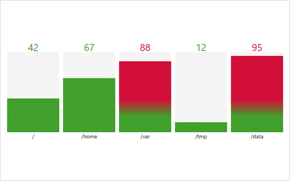</a><br><b>&lt;BarGauge&gt;</b><br><a href="docs/bar-gauge/guide.md">Guide</a> · <a href="docs/bar-gauge/api.md">API</a> · <a href="docs/bar-gauge/examples.md">Examples</a></td>
<td align="center" valign="top" width="25%"><a href="docs/flame-graph/examples.md">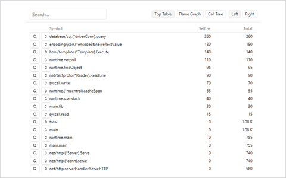</a><br><b>&lt;FlameGraph&gt;</b><br><a href="docs/flame-graph/guide.md">Guide</a> · <a href="docs/flame-graph/api.md">API</a> · <a href="docs/flame-graph/examples.md">Examples</a></td>
<td align="center" valign="top" width="25%"><a href="docs/trend/examples.md">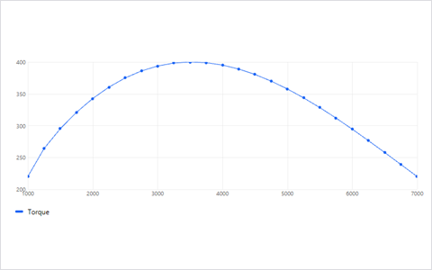</a><br><b>&lt;Trend&gt;</b><br><a href="docs/trend/guide.md">Guide</a> · <a href="docs/trend/api.md">API</a> · <a href="docs/trend/examples.md">Examples</a></td>
</tr>
<tr>
<td align="center" valign="top" width="25%"><a href="docs/traces/examples.md">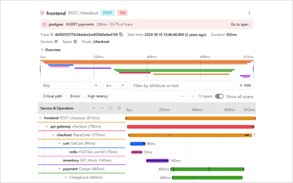</a><br><b>&lt;Traces&gt;</b><br><a href="docs/traces/guide.md">Guide</a> · <a href="docs/traces/api.md">API</a> · <a href="docs/traces/examples.md">Examples</a></td>
<td align="center" valign="top" width="25%"><a href="docs/heatmap/examples.md">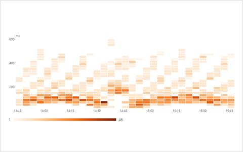</a><br><b>&lt;Heatmap&gt;</b><br><a href="docs/heatmap/guide.md">Guide</a> · <a href="docs/heatmap/api.md">API</a> · <a href="docs/heatmap/examples.md">Examples</a></td>
<td align="center" valign="top" width="25%"><a href="docs/state-timeline/examples.md">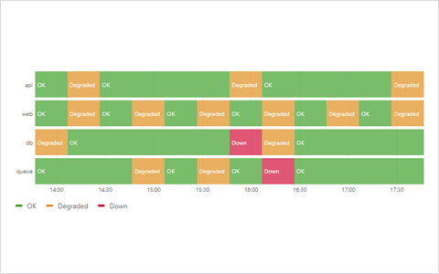</a><br><b>&lt;StateTimeline&gt;</b><br><a href="docs/state-timeline/guide.md">Guide</a> · <a href="docs/state-timeline/api.md">API</a> · <a href="docs/state-timeline/examples.md">Examples</a></td>
<td align="center" valign="top" width="25%"><a href="docs/status-history/examples.md">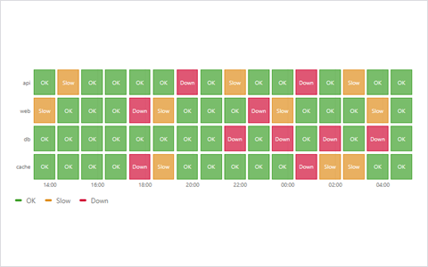</a><br><b>&lt;StatusHistory&gt;</b><br><a href="docs/status-history/guide.md">Guide</a> · <a href="docs/status-history/api.md">API</a> · <a href="docs/status-history/examples.md">Examples</a></td>
</tr>
<tr>
<td align="center" valign="top" width="25%"><a href="docs/histogram/examples.md">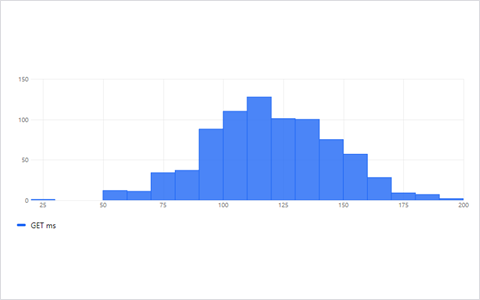</a><br><b>&lt;Histogram&gt;</b><br><a href="docs/histogram/guide.md">Guide</a> · <a href="docs/histogram/api.md">API</a> · <a href="docs/histogram/examples.md">Examples</a></td>
<td align="center" valign="top" width="25%"><a href="docs/stat/examples.md">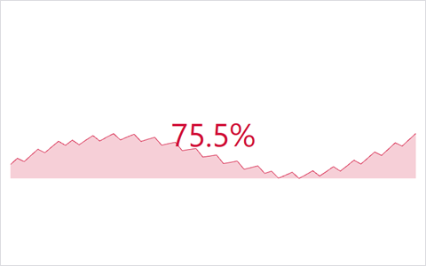</a><br><b>&lt;Stat&gt;</b><br><a href="docs/stat/guide.md">Guide</a> · <a href="docs/stat/api.md">API</a> · <a href="docs/stat/examples.md">Examples</a></td>
<td align="center" valign="top" width="25%"><a href="docs/gauge/examples.md">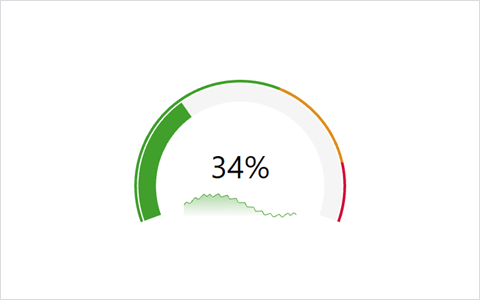</a><br><b>&lt;Gauge&gt;</b><br><a href="docs/gauge/guide.md">Guide</a> · <a href="docs/gauge/api.md">API</a> · <a href="docs/gauge/examples.md">Examples</a></td>
<td align="center" valign="top" width="25%"><a href="docs/time-series/examples.md">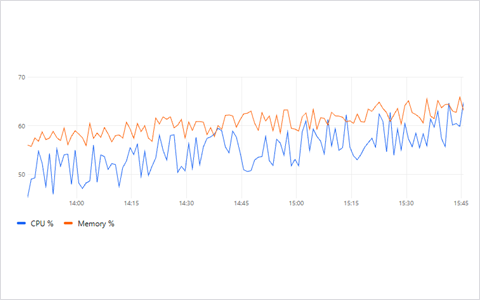</a><br><b>&lt;TimeSeries&gt;</b><br><a href="docs/time-series/guide.md">Guide</a> · <a href="docs/time-series/api.md">API</a> · <a href="docs/time-series/examples.md">Examples</a></td>
</tr>
<tr>
<td align="center" valign="top" width="25%"><a href="docs/candlestick/examples.md">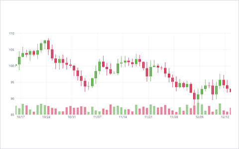</a><br><b>&lt;Candlestick&gt;</b><br><a href="docs/candlestick/guide.md">Guide</a> · <a href="docs/candlestick/api.md">API</a> · <a href="docs/candlestick/examples.md">Examples</a></td>
<td align="center" valign="top" width="25%"><a href="docs/node-graph/examples.md">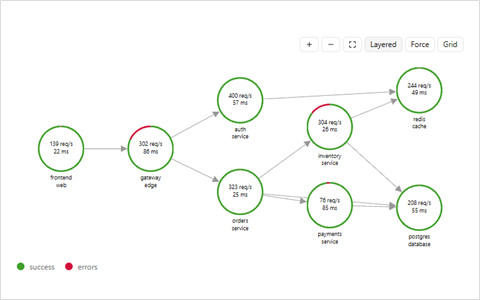</a><br><b>&lt;NodeGraph&gt;</b><br><a href="docs/node-graph/guide.md">Guide</a> · <a href="docs/node-graph/api.md">API</a> · <a href="docs/node-graph/examples.md">Examples</a></td>
<td></td>
<td></td>
</tr>
</table>

### Derived charts

Built from the charts above, so they share their hover, tooltips, legends and theming.

#### Category charts

One bar, dot or line per named item.

<table>
<tr>
<td align="center" valign="top" width="25%"><a href="docs/category/examples.md#lollipop">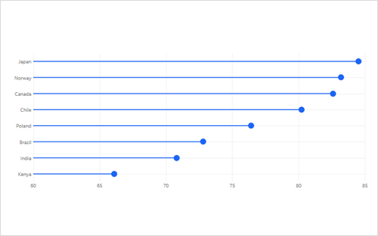</a><br><b>&lt;Lollipop&gt;</b><br><a href="docs/category/guide.md">Guide</a> · <a href="docs/category/api.md#lollipop">API</a> · <a href="docs/category/examples.md#lollipop">Examples</a></td>
<td align="center" valign="top" width="25%"><a href="docs/category/examples.md#dumbbell">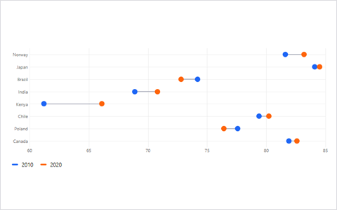</a><br><b>&lt;Dumbbell&gt;</b><br><a href="docs/category/guide.md">Guide</a> · <a href="docs/category/api.md#dumbbell">API</a> · <a href="docs/category/examples.md#dumbbell">Examples</a></td>
<td align="center" valign="top" width="25%"><a href="docs/category/examples.md#slope">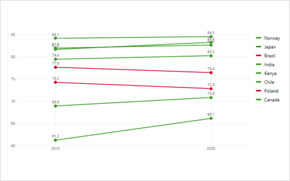</a><br><b>&lt;Slope&gt;</b><br><a href="docs/category/guide.md">Guide</a> · <a href="docs/category/api.md#slope">API</a> · <a href="docs/category/examples.md#slope">Examples</a></td>
<td align="center" valign="top" width="25%"><a href="docs/category/examples.md#bump">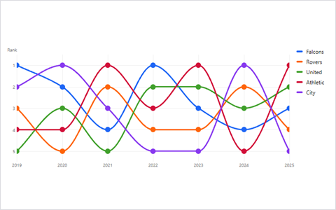</a><br><b>&lt;Bump&gt;</b><br><a href="docs/category/guide.md">Guide</a> · <a href="docs/category/api.md#bump">API</a> · <a href="docs/category/examples.md#bump">Examples</a></td>
</tr>
<tr>
<td align="center" valign="top" width="25%"><a href="docs/category/examples.md#backtoback">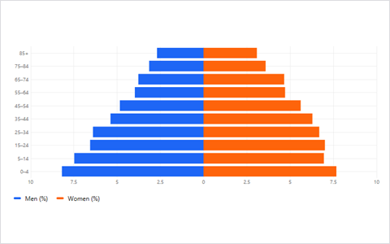</a><br><b>&lt;BackToBack&gt;</b><br><a href="docs/category/guide.md">Guide</a> · <a href="docs/category/api.md#backtoback">API</a> · <a href="docs/category/examples.md#backtoback">Examples</a></td>
<td align="center" valign="top" width="25%"><a href="docs/category/examples.md#waterfall">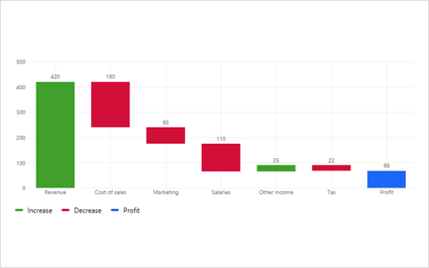</a><br><b>&lt;Waterfall&gt;</b><br><a href="docs/category/guide.md">Guide</a> · <a href="docs/category/api.md#waterfall">API</a> · <a href="docs/category/examples.md#waterfall">Examples</a></td>
<td align="center" valign="top" width="25%"><a href="docs/category/examples.md#bullet">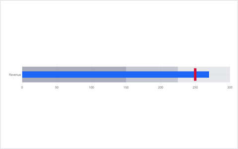</a><br><b>&lt;Bullet&gt;</b><br><a href="docs/category/guide.md">Guide</a> · <a href="docs/category/api.md#bullet">API</a> · <a href="docs/category/examples.md#bullet">Examples</a></td>
<td align="center" valign="top" width="25%"><a href="docs/category/examples.md#funnel">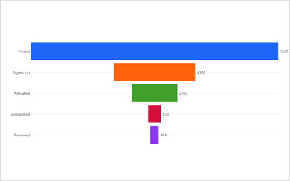</a><br><b>&lt;Funnel&gt;</b><br><a href="docs/category/guide.md">Guide</a> · <a href="docs/category/api.md#funnel">API</a> · <a href="docs/category/examples.md#funnel">Examples</a></td>
</tr>
<tr>
<td align="center" valign="top" width="25%"><a href="docs/category/examples.md#forest">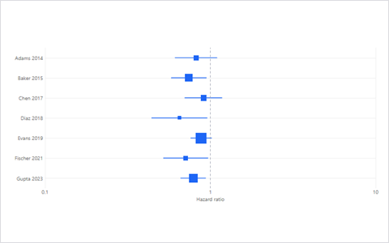</a><br><b>&lt;Forest&gt;</b><br><a href="docs/category/guide.md">Guide</a> · <a href="docs/category/api.md#forest">API</a> · <a href="docs/category/examples.md#forest">Examples</a></td>
<td></td>
<td></td>
<td></td>
</tr>
</table>

#### Finance charts

Price trends without the noise.

<table>
<tr>
<td align="center" valign="top" width="25%"><a href="docs/finance/examples.md#heikinashi">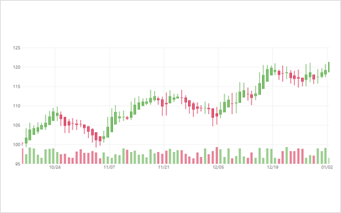</a><br><b>&lt;HeikinAshi&gt;</b><br><a href="docs/finance/guide.md">Guide</a> · <a href="docs/finance/api.md#heikinashi">API</a> · <a href="docs/finance/examples.md#heikinashi">Examples</a></td>
<td align="center" valign="top" width="25%"><a href="docs/finance/examples.md#renko">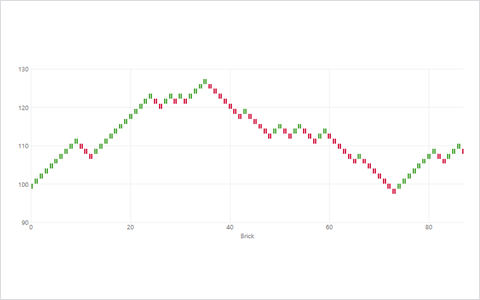</a><br><b>&lt;Renko&gt;</b><br><a href="docs/finance/guide.md">Guide</a> · <a href="docs/finance/api.md#renko">API</a> · <a href="docs/finance/examples.md#renko">Examples</a></td>
<td align="center" valign="top" width="25%"><a href="docs/finance/examples.md#kagi">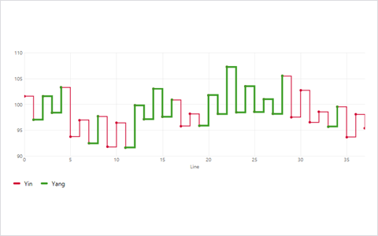</a><br><b>&lt;Kagi&gt;</b><br><a href="docs/finance/guide.md">Guide</a> · <a href="docs/finance/api.md#kagi">API</a> · <a href="docs/finance/examples.md#kagi">Examples</a></td>
<td align="center" valign="top" width="25%"><a href="docs/finance/examples.md#pointfigure">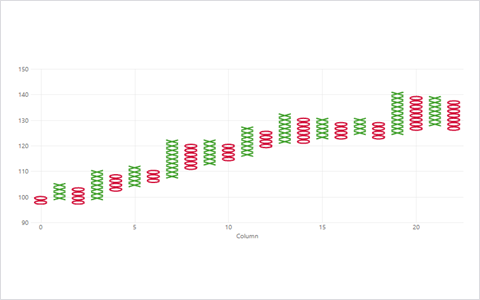</a><br><b>&lt;PointFigure&gt;</b><br><a href="docs/finance/guide.md">Guide</a> · <a href="docs/finance/api.md#pointfigure">API</a> · <a href="docs/finance/examples.md#pointfigure">Examples</a></td>
</tr>
</table>

#### Quality charts

Causes, process stability, method agreement.

<table>
<tr>
<td align="center" valign="top" width="25%"><a href="docs/quality/examples.md#pareto">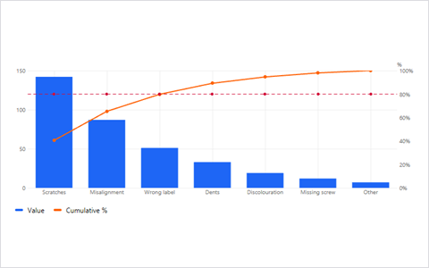</a><br><b>&lt;Pareto&gt;</b><br><a href="docs/quality/guide.md">Guide</a> · <a href="docs/quality/api.md#pareto">API</a> · <a href="docs/quality/examples.md#pareto">Examples</a></td>
<td align="center" valign="top" width="25%"><a href="docs/quality/examples.md#controlchart">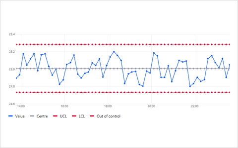</a><br><b>&lt;ControlChart&gt;</b><br><a href="docs/quality/guide.md">Guide</a> · <a href="docs/quality/api.md#controlchart">API</a> · <a href="docs/quality/examples.md#controlchart">Examples</a></td>
<td align="center" valign="top" width="25%"><a href="docs/quality/examples.md#blandaltman">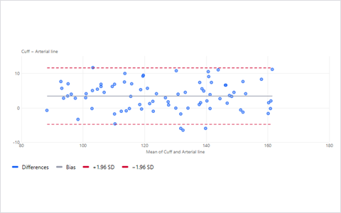</a><br><b>&lt;BlandAltman&gt;</b><br><a href="docs/quality/guide.md">Guide</a> · <a href="docs/quality/api.md#blandaltman">API</a> · <a href="docs/quality/examples.md#blandaltman">Examples</a></td>
<td></td>
</tr>
</table>

#### Distribution charts

Every value, distribution shapes, dense series.

<table>
<tr>
<td align="center" valign="top" width="25%"><a href="docs/distribution/examples.md#barcode">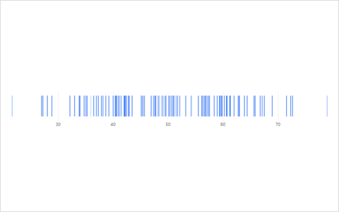</a><br><b>&lt;Barcode&gt;</b><br><a href="docs/distribution/guide.md">Guide</a> · <a href="docs/distribution/api.md#barcode">API</a> · <a href="docs/distribution/examples.md#barcode">Examples</a></td>
<td align="center" valign="top" width="25%"><a href="docs/distribution/examples.md#beeswarm">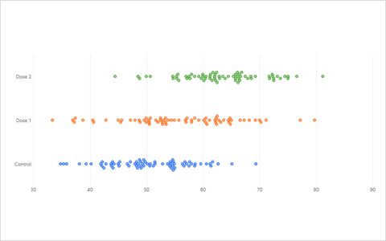</a><br><b>&lt;Beeswarm&gt;</b><br><a href="docs/distribution/guide.md">Guide</a> · <a href="docs/distribution/api.md#beeswarm">API</a> · <a href="docs/distribution/examples.md#beeswarm">Examples</a></td>
<td align="center" valign="top" width="25%"><a href="docs/distribution/examples.md#ridgeline">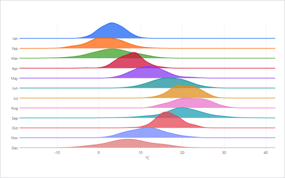</a><br><b>&lt;Ridgeline&gt;</b><br><a href="docs/distribution/guide.md">Guide</a> · <a href="docs/distribution/api.md#ridgeline">API</a> · <a href="docs/distribution/examples.md#ridgeline">Examples</a></td>
<td align="center" valign="top" width="25%"><a href="docs/distribution/examples.md#horizon">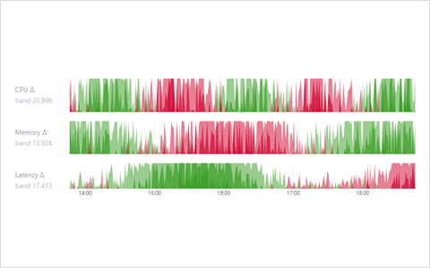</a><br><b>&lt;Horizon&gt;</b><br><a href="docs/distribution/guide.md">Guide</a> · <a href="docs/distribution/api.md#horizon">API</a> · <a href="docs/distribution/examples.md#horizon">Examples</a></td>
</tr>
</table>

#### Matrix charts

Frequencies over time, weight matrices, shares of a whole.

<table>
<tr>
<td align="center" valign="top" width="25%"><a href="docs/matrix/examples.md#spectrogram">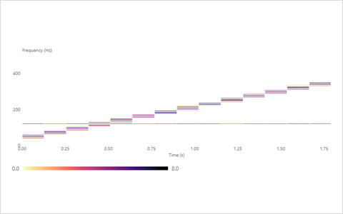</a><br><b>&lt;Spectrogram&gt;</b><br><a href="docs/matrix/guide.md">Guide</a> · <a href="docs/matrix/api.md#spectrogram">API</a> · <a href="docs/matrix/examples.md#spectrogram">Examples</a></td>
<td align="center" valign="top" width="25%"><a href="docs/matrix/examples.md#attentionmap">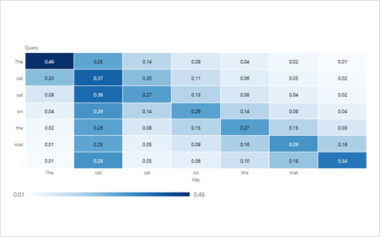</a><br><b>&lt;AttentionMap&gt;</b><br><a href="docs/matrix/guide.md">Guide</a> · <a href="docs/matrix/api.md#attentionmap">API</a> · <a href="docs/matrix/examples.md#attentionmap">Examples</a></td>
<td align="center" valign="top" width="25%"><a href="docs/matrix/examples.md#waffle">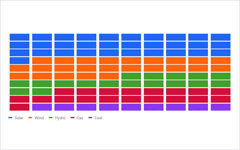</a><br><b>&lt;Waffle&gt;</b><br><a href="docs/matrix/guide.md">Guide</a> · <a href="docs/matrix/api.md#waffle">API</a> · <a href="docs/matrix/examples.md#waffle">Examples</a></td>
<td></td>
</tr>
</table>

#### Flow, tree and profile charts

Plans, flows, funnels, trees, clusters and multi-measure profiles.

<table>
<tr>
<td align="center" valign="top" width="25%"><a href="docs/flow/examples.md#gantt">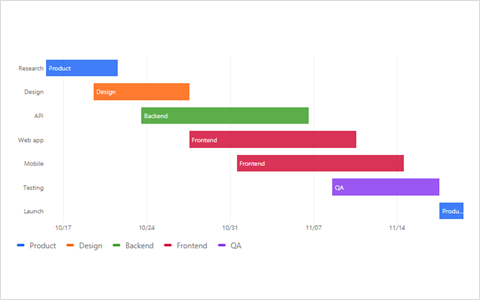</a><br><b>&lt;Gantt&gt;</b><br><a href="docs/flow/guide.md">Guide</a> · <a href="docs/flow/api.md#gantt">API</a> · <a href="docs/flow/examples.md#gantt">Examples</a></td>
<td align="center" valign="top" width="25%"><a href="docs/flow/examples.md#sankey">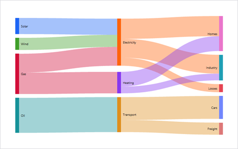</a><br><b>&lt;Sankey&gt;</b><br><a href="docs/flow/guide.md">Guide</a> · <a href="docs/flow/api.md#sankey">API</a> · <a href="docs/flow/examples.md#sankey">Examples</a></td>
<td align="center" valign="top" width="25%"><a href="docs/flow/examples.md#alluvial">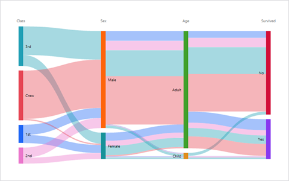</a><br><b>&lt;Alluvial&gt;</b><br><a href="docs/flow/guide.md">Guide</a> · <a href="docs/flow/api.md#alluvial">API</a> · <a href="docs/flow/examples.md#alluvial">Examples</a></td>
<td align="center" valign="top" width="25%"><a href="docs/flow/examples.md#icicle">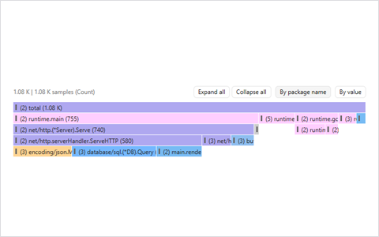</a><br><b>&lt;Icicle&gt;</b><br><a href="docs/flow/guide.md">Guide</a> · <a href="docs/flow/api.md#icicle">API</a> · <a href="docs/flow/examples.md#icicle">Examples</a></td>
</tr>
<tr>
<td align="center" valign="top" width="25%"><a href="docs/flow/examples.md#dendrogram">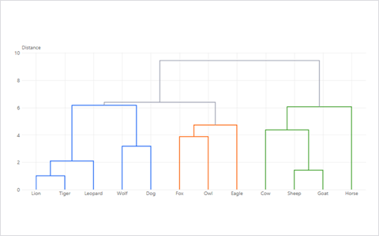</a><br><b>&lt;Dendrogram&gt;</b><br><a href="docs/flow/guide.md">Guide</a> · <a href="docs/flow/api.md#dendrogram">API</a> · <a href="docs/flow/examples.md#dendrogram">Examples</a></td>
<td align="center" valign="top" width="25%"><a href="docs/flow/examples.md#spider">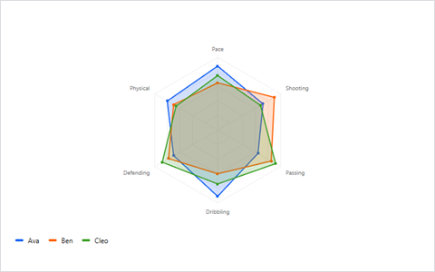</a><br><b>&lt;Spider&gt;</b><br><a href="docs/flow/guide.md">Guide</a> · <a href="docs/flow/api.md#spider">API</a> · <a href="docs/flow/examples.md#spider">Examples</a></td>
<td align="center" valign="top" width="25%"><a href="docs/flow/examples.md#nightingalerose">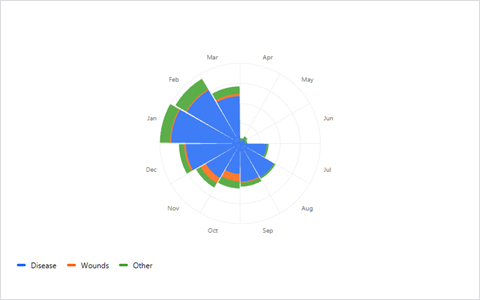</a><br><b>&lt;NightingaleRose&gt;</b><br><a href="docs/flow/guide.md">Guide</a> · <a href="docs/flow/api.md#nightingalerose">API</a> · <a href="docs/flow/examples.md#nightingalerose">Examples</a></td>
<td align="center" valign="top" width="25%"><a href="docs/flow/examples.md#parallelcoordinates">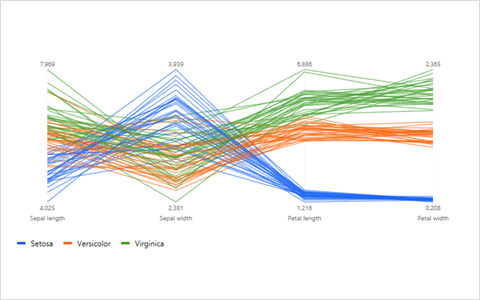</a><br><b>&lt;ParallelCoordinates&gt;</b><br><a href="docs/flow/guide.md">Guide</a> · <a href="docs/flow/api.md#parallelcoordinates">API</a> · <a href="docs/flow/examples.md#parallelcoordinates">Examples</a></td>
</tr>
<tr>
<td align="center" valign="top" width="25%"><a href="docs/flow/examples.md#sankeyfunnel">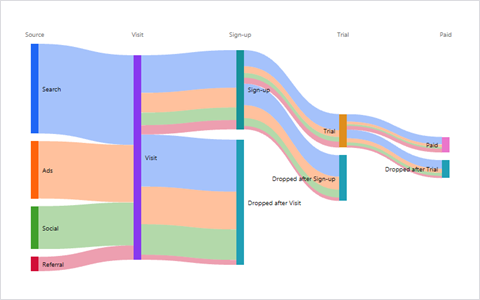</a><br><b>&lt;SankeyFunnel&gt;</b><br><a href="docs/flow/guide.md">Guide</a> · <a href="docs/flow/api.md#sankeyfunnel">API</a> · <a href="docs/flow/examples.md#sankeyfunnel">Examples</a></td>
<td></td>
<td></td>
<td></td>
</tr>
</table>

#### Science charts

Electronics, finance, dynamics, astronomy, biochemistry, geology, control, antennas, fields, weather, RF, high-speed links.

<table>
<tr>
<td align="center" valign="top" width="25%"><a href="docs/science/examples.md#oscilloscope">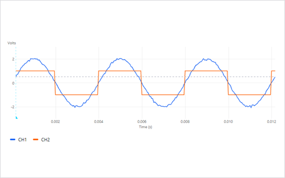</a><br><b>&lt;Oscilloscope&gt;</b><br><a href="docs/science/guide.md">Guide</a> · <a href="docs/science/api.md#oscilloscope">API</a> · <a href="docs/science/examples.md#oscilloscope">Examples</a></td>
<td align="center" valign="top" width="25%"><a href="docs/science/examples.md#efficientfrontier">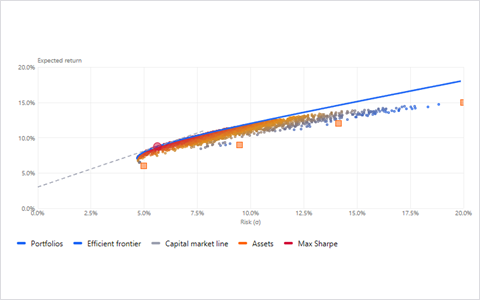</a><br><b>&lt;EfficientFrontier&gt;</b><br><a href="docs/science/guide.md">Guide</a> · <a href="docs/science/api.md#efficientfrontier">API</a> · <a href="docs/science/examples.md#efficientfrontier">Examples</a></td>
<td align="center" valign="top" width="25%"><a href="docs/science/examples.md#phaseportrait">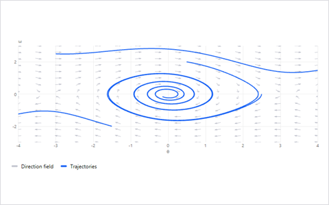</a><br><b>&lt;PhasePortrait&gt;</b><br><a href="docs/science/guide.md">Guide</a> · <a href="docs/science/api.md#phaseportrait">API</a> · <a href="docs/science/examples.md#phaseportrait">Examples</a></td>
<td align="center" valign="top" width="25%"><a href="docs/science/examples.md#poincaremap">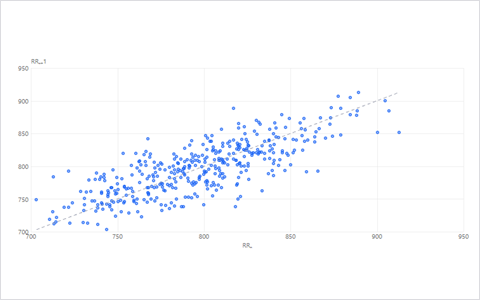</a><br><b>&lt;PoincareMap&gt;</b><br><a href="docs/science/guide.md">Guide</a> · <a href="docs/science/api.md#poincaremap">API</a> · <a href="docs/science/examples.md#poincaremap">Examples</a></td>
</tr>
<tr>
<td align="center" valign="top" width="25%"><a href="docs/science/examples.md#bifurcation"></a><br><b>&lt;Bifurcation&gt;</b><br><a href="docs/science/guide.md">Guide</a> · <a href="docs/science/api.md#bifurcation">API</a> · <a href="docs/science/examples.md#bifurcation">Examples</a></td>
<td align="center" valign="top" width="25%"><a href="docs/science/examples.md#hrdiagram"></a><br><b>&lt;HrDiagram&gt;</b><br><a href="docs/science/guide.md">Guide</a> · <a href="docs/science/api.md#hrdiagram">API</a> · <a href="docs/science/examples.md#hrdiagram">Examples</a></td>
<td align="center" valign="top" width="25%"><a href="docs/science/examples.md#ramachandran"></a><br><b>&lt;Ramachandran&gt;</b><br><a href="docs/science/guide.md">Guide</a> · <a href="docs/science/api.md#ramachandran">API</a> · <a href="docs/science/examples.md#ramachandran">Examples</a></td>
<td align="center" valign="top" width="25%"><a href="docs/science/examples.md#harker"></a><br><b>&lt;Harker&gt;</b><br><a href="docs/science/guide.md">Guide</a> · <a href="docs/science/api.md#harker">API</a> · <a href="docs/science/examples.md#harker">Examples</a></td>
</tr>
<tr>
<td align="center" valign="top" width="25%"><a href="docs/science/examples.md#rootlocus"></a><br><b>&lt;RootLocus&gt;</b><br><a href="docs/science/guide.md">Guide</a> · <a href="docs/science/api.md#rootlocus">API</a> · <a href="docs/science/examples.md#rootlocus">Examples</a></td>
<td align="center" valign="top" width="25%"><a href="docs/science/examples.md#radiationpattern"></a><br><b>&lt;RadiationPattern&gt;</b><br><a href="docs/science/guide.md">Guide</a> · <a href="docs/science/api.md#radiationpattern">API</a> · <a href="docs/science/examples.md#radiationpattern">Examples</a></td>
<td align="center" valign="top" width="25%"><a href="docs/science/examples.md#quiver"></a><br><b>&lt;Quiver&gt;</b><br><a href="docs/science/guide.md">Guide</a> · <a href="docs/science/api.md#quiver">API</a> · <a href="docs/science/examples.md#quiver">Examples</a></td>
<td align="center" valign="top" width="25%"><a href="docs/science/examples.md#hodograph"></a><br><b>&lt;Hodograph&gt;</b><br><a href="docs/science/guide.md">Guide</a> · <a href="docs/science/api.md#hodograph">API</a> · <a href="docs/science/examples.md#hodograph">Examples</a></td>
</tr>
<tr>
<td align="center" valign="top" width="25%"><a href="docs/science/examples.md#smithchart"></a><br><b>&lt;SmithChart&gt;</b><br><a href="docs/science/guide.md">Guide</a> · <a href="docs/science/api.md#smithchart">API</a> · <a href="docs/science/examples.md#smithchart">Examples</a></td>
<td align="center" valign="top" width="25%"><a href="docs/science/examples.md#eyediagram"></a><br><b>&lt;EyeDiagram&gt;</b><br><a href="docs/science/guide.md">Guide</a> · <a href="docs/science/api.md#eyediagram">API</a> · <a href="docs/science/examples.md#eyediagram">Examples</a></td>
<td></td>
<td></td>
</tr>
</table>

#### Diagram charts

Market maps, status grids, hierarchies, flows, links, root causes, set overlaps, genomes, alignments, text.

<table>
<tr>
<td align="center" valign="top" width="25%"><a href="docs/diagram/examples.md#mekko"></a><br><b>&lt;Mekko&gt;</b><br><a href="docs/diagram/guide.md">Guide</a> · <a href="docs/diagram/api.md#mekko">API</a> · <a href="docs/diagram/examples.md#mekko">Examples</a></td>
<td align="center" valign="top" width="25%"><a href="docs/diagram/examples.md#honeycomb"></a><br><b>&lt;HoneyComb&gt;</b><br><a href="docs/diagram/guide.md">Guide</a> · <a href="docs/diagram/api.md#honeycomb">API</a> · <a href="docs/diagram/examples.md#honeycomb">Examples</a></td>
<td align="center" valign="top" width="25%"><a href="docs/diagram/examples.md#sunburst"></a><br><b>&lt;Sunburst&gt;</b><br><a href="docs/diagram/guide.md">Guide</a> · <a href="docs/diagram/api.md#sunburst">API</a> · <a href="docs/diagram/examples.md#sunburst">Examples</a></td>
<td align="center" valign="top" width="25%"><a href="docs/diagram/examples.md#chorddiagram"></a><br><b>&lt;ChordDiagram&gt;</b><br><a href="docs/diagram/guide.md">Guide</a> · <a href="docs/diagram/api.md#chorddiagram">API</a> · <a href="docs/diagram/examples.md#chorddiagram">Examples</a></td>
</tr>
<tr>
<td align="center" valign="top" width="25%"><a href="docs/diagram/examples.md#arcdiagram"></a><br><b>&lt;ArcDiagram&gt;</b><br><a href="docs/diagram/guide.md">Guide</a> · <a href="docs/diagram/api.md#arcdiagram">API</a> · <a href="docs/diagram/examples.md#arcdiagram">Examples</a></td>
<td align="center" valign="top" width="25%"><a href="docs/diagram/examples.md#ishikawa"></a><br><b>&lt;Ishikawa&gt;</b><br><a href="docs/diagram/guide.md">Guide</a> · <a href="docs/diagram/api.md#ishikawa">API</a> · <a href="docs/diagram/examples.md#ishikawa">Examples</a></td>
<td align="center" valign="top" width="25%"><a href="docs/diagram/examples.md#venn"></a><br><b>&lt;Venn&gt;</b><br><a href="docs/diagram/guide.md">Guide</a> · <a href="docs/diagram/api.md#venn">API</a> · <a href="docs/diagram/examples.md#venn">Examples</a></td>
<td align="center" valign="top" width="25%"><a href="docs/diagram/examples.md#upset"></a><br><b>&lt;UpSet&gt;</b><br><a href="docs/diagram/guide.md">Guide</a> · <a href="docs/diagram/api.md#upset">API</a> · <a href="docs/diagram/examples.md#upset">Examples</a></td>
</tr>
<tr>
<td align="center" valign="top" width="25%"><a href="docs/diagram/examples.md#circos"></a><br><b>&lt;Circos&gt;</b><br><a href="docs/diagram/guide.md">Guide</a> · <a href="docs/diagram/api.md#circos">API</a> · <a href="docs/diagram/examples.md#circos">Examples</a></td>
<td align="center" valign="top" width="25%"><a href="docs/diagram/examples.md#warpedwaffle"></a><br><b>&lt;WarpedWaffle&gt;</b><br><a href="docs/diagram/guide.md">Guide</a> · <a href="docs/diagram/api.md#warpedwaffle">API</a> · <a href="docs/diagram/examples.md#warpedwaffle">Examples</a></td>
<td align="center" valign="top" width="25%"><a href="docs/diagram/examples.md#sequencelogo"></a><br><b>&lt;SequenceLogo&gt;</b><br><a href="docs/diagram/guide.md">Guide</a> · <a href="docs/diagram/api.md#sequencelogo">API</a> · <a href="docs/diagram/examples.md#sequencelogo">Examples</a></td>
<td align="center" valign="top" width="25%"><a href="docs/diagram/examples.md#wordcloud"></a><br><b>&lt;WordCloud&gt;</b><br><a href="docs/diagram/guide.md">Guide</a> · <a href="docs/diagram/api.md#wordcloud">API</a> · <a href="docs/diagram/examples.md#wordcloud">Examples</a></td>
</tr>
</table>

#### Hybrid charts

Flows between two sets with exact values, and grouped networks sized by value.

<table>
<tr>
<td align="center" valign="top" width="25%"><a href="docs/hybrid/examples.md#sankeymatrix"></a><br><b>&lt;SankeyMatrix&gt;</b><br><a href="docs/hybrid/guide.md">Guide</a> · <a href="docs/hybrid/api.md#sankeymatrix">API</a> · <a href="docs/hybrid/examples.md#sankeymatrix">Examples</a></td>
<td align="center" valign="top" width="25%"><a href="docs/hybrid/examples.md#treemapforce"></a><br><b>&lt;TreemapForce&gt;</b><br><a href="docs/hybrid/guide.md">Guide</a> · <a href="docs/hybrid/api.md#treemapforce">API</a> · <a href="docs/hybrid/examples.md#treemapforce">Examples</a></td>
<td></td>
<td></td>
</tr>
</table>

#### Earth and lab science charts

Three-part mixtures, water chemistry, atmospheric soundings, maps.

<table>
<tr>
<td align="center" valign="top" width="25%"><a href="docs/earth/examples.md#ternary"></a><br><b>&lt;Ternary&gt;</b><br><a href="docs/earth/guide.md">Guide</a> · <a href="docs/earth/api.md#ternary">API</a> · <a href="docs/earth/examples.md#ternary">Examples</a></td>
<td align="center" valign="top" width="25%"><a href="docs/earth/examples.md#ternarycontour"></a><br><b>&lt;TernaryContour&gt;</b><br><a href="docs/earth/guide.md">Guide</a> · <a href="docs/earth/api.md#ternarycontour">API</a> · <a href="docs/earth/examples.md#ternarycontour">Examples</a></td>
<td align="center" valign="top" width="25%"><a href="docs/earth/examples.md#piper"></a><br><b>&lt;Piper&gt;</b><br><a href="docs/earth/guide.md">Guide</a> · <a href="docs/earth/api.md#piper">API</a> · <a href="docs/earth/examples.md#piper">Examples</a></td>
<td align="center" valign="top" width="25%"><a href="docs/earth/examples.md#stuve"></a><br><b>&lt;Stuve&gt;</b><br><a href="docs/earth/guide.md">Guide</a> · <a href="docs/earth/api.md#stuve">API</a> · <a href="docs/earth/examples.md#stuve">Examples</a></td>
</tr>
<tr>
<td align="center" valign="top" width="25%"><a href="docs/earth/examples.md#tephigram"></a><br><b>&lt;Tephigram&gt;</b><br><a href="docs/earth/guide.md">Guide</a> · <a href="docs/earth/api.md#tephigram">API</a> · <a href="docs/earth/examples.md#tephigram">Examples</a></td>
<td align="center" valign="top" width="25%"><a href="docs/earth/examples.md#choropleth"></a><br><b>&lt;Choropleth&gt;</b><br><a href="docs/earth/guide.md">Guide</a> · <a href="docs/earth/api.md#choropleth">API</a> · <a href="docs/earth/examples.md#choropleth">Examples</a></td>
<td></td>
<td></td>
</tr>
</table>

Also see [Theming](docs/theming.md) for chart colours and light/dark mode.

## Examples and tests

```sh
cargo run --example gallery        # every chart and example, in a sidebar
cargo run --example gallery -- --screenshot gauge.ppm --chart "Gauge" [--dark] [--size 1280x900] [--hover 400,300]
cargo test                         # unit tests + headless charts (tests/)
```

`--screenshot` renders one chart's page headless to a PPM image. The tests drive real windows
through blenderui's simulated input: the revision cache (`tests/cache.rs`), hover tooltip and
crosshair, legend isolate / restore, drag-to-zoom with `on_select` and double-click home, the node
graph's zoom buttons, theme switching (`tests/charts.rs`), and every gallery example rendered
headless (`tests/gallery.rs`). A chart's tooltip card has the id `chart-tooltip`, legend entries
`legend-<index>`.

## Coming from zopra-charts

Change the imports (`zopra_charts` → `bui_charts`, `gpui_kit` / `zopra` → `blenderui::prelude`) and
`view!` → `rsx!`. Tags, props and their types, typed children (`<Series>`, `<TrendSeries>`,
`<StateRow>`, `<Stage>` ..), data formats and theme files are the same. Otherwise:

- `class` takes Tailwind classes as a string (`class="h-64"`), not a `StyleRefinement`.
- Builders are `<Tag>Props` (`XYChartProps`, `GaugeProps` ..) with the tag as an alias;
  `.render()` takes no window or app (`XYChartProps::new().data(d).children(..).render()`).
- Components get no `window` or `cx`; signals are blenderui's (`.get()`, `.set()`, `.update()`,
  `.with()`), not callable.
- `Dataset<T>` lends its rows: `read(|rows, schema| ..)` (with `rows(..)` and `schema(..)` on top of
  it) and `revision()`, both without `cx`; `Revision::of(signal)` likewise. A signal's revision is
  noticed by a memo in the chart.
- `ChartTheme::load(json)` and `ChartTheme::colors()` take no `cx`; `colors()` returns `Colors`, which
  derefs to `ChartColors`. Light / dark follows the kit theme (`blenderui::set_theme`); after a
  switch, `cx.notify_all()` re-renders.
- `Legend`, `Tooltip`, `Sizing`, `HeatmapTooltip`, `HeatmapLegend` and `ArcSection` are no longer
  `Eq`: blenderui's `Pixels` and `Rgba` are not.
- `Color<T>` has no separate `From<Rgba>` (blenderui's `Hsla` is its `Rgba`); `OxideField` has no
  `FromChild` (typed children need none).
- `TraceData::into_signal(slot)` and `ProfileData::into_signal(slot)` take no `cx` (`TraceData` also
  has `revision(slot)`).
- Pointer gestures listen on the chart's canvas, not the whole window: a drag released outside the
  chart ends when the pointer comes back. Ctrl+wheel zoom inside a scroll container also scrolls it.
- Traces' "Export as JSON" writes `Trace-<id>.json` to the working directory (blenderui has no save
  dialog). The flame graph's split view is a fixed half and half (no resizable split in blenderui).
- Charts no longer set element ids on their roots; the control icons are line icons bui-charts draws.

## License

MIT OR Apache-2.0 (see `LICENSE`). `blenderui` is GPL-3.0-or-later.
